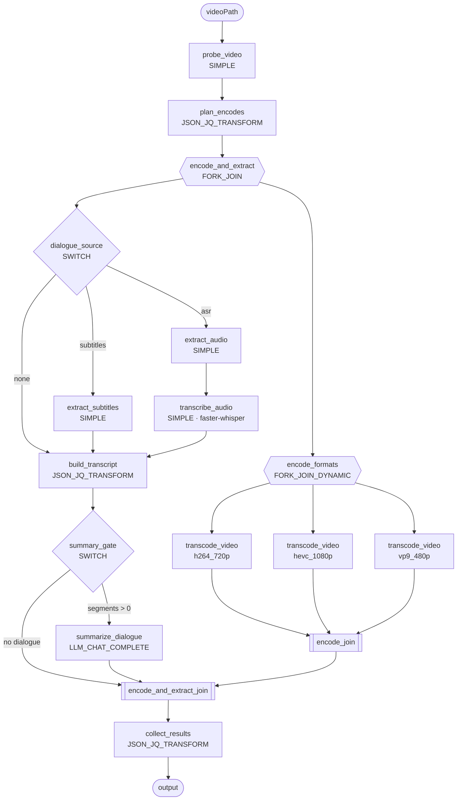

# video_dialogue_pipeline

A Conductor workflow that takes a video file, encodes it into several formats in parallel, extracts its dialogue and summarizes it with an LLM.



- **Encoding** fans out one `transcode_video` task per entry in `formats` (at most 10), all running in parallel.
- **Dialogue** comes from an embedded subtitle track if the file has one. Otherwise the audio is transcribed with faster-whisper. `dialogueSource` can force either path.
- **Summary** uses Conductor's built-in `LLM_CHAT_COMPLETE` task, with no custom worker or HTTP call. It runs only when dialogue was found.

## Files

| File | What it is |
|---|---|
| `workflow.json` | Workflow definition (`video_dialogue_pipeline` v1) |
| `taskdefs.json` | Task definitions for the 5 SIMPLE tasks (timeouts, retries, concurrency limits) |
| `workers.py` | Python workers (ffmpeg / ffprobe / faster-whisper) |
| `requirements.txt` | Worker dependencies |
| `setup.sh` | One-shot setup / run / stop script |
| `sample/meeting.mp4` | 20 s test clip with an embedded subtitle track (`sample/dialogue.srt`) |

## Setup

Requirements: Python 3.10+, Java 21+, `ffmpeg`/`ffprobe`, `curl` and `jq`. The worker host must be able to read `videoPath` and write to `outputDir`.

The LLM provider key must be in the **server's** environment. For Claude, use a workspace-scoped key (`sk-ant-api03-…`); keys not tied to a workspace are rejected because Conductor can't send the `anthropic-workspace-id` header. In a Claude Code cloud session, add `ANTHROPIC_API_KEY` as an environment variable in the environment settings; don't paste it into chat.

```bash
./setup.sh --run     # CLI + venv + local server + register + workers, then run sample/meeting.mp4
./setup.sh           # same, without the sample run (safe to re-run)
./setup.sh --stop    # stop workers and the local server
```

`setup.sh` keeps all of its state inside this directory: `.bin/` (Conductor CLI), `.venv/` and `.run/` (server DB, `workers.log`). To use an existing server instead of starting a local one, export `CONDUCTOR_SERVER_URL` first.

## Run

```bash
.bin/conductor workflow start -w video_dialogue_pipeline \
  -i '{"videoPath": "/data/in/talk.mov", "outputDir": "/data/out/talk"}'
```

### Inputs

| Input | Default | Notes |
|---|---|---|
| `videoPath` | (required) | Absolute path readable by the workers |
| `outputDir` | `<video dir>/<stem>_outputs` | Created if missing |
| `formats` | h264 720p MP4, HEVC 1080p MP4, VP9 480p WebM | List of `{name, ext, videoCodec, audioCodec, height?, audioBitrate?, videoArgs?[], extraArgs?[]}`. `height` caps the output height and never upscales. `[]` skips encoding. |
| `dialogueSource` | `auto` | `auto` (subtitles if present, otherwise ASR), `subtitles`, or `asr` |
| `language` | auto-detect | ISO code passed to Whisper, e.g. `en` |
| `whisperModel` | `$WHISPER_MODEL` or `small` | Any faster-whisper model size/path |
| `llmProvider` / `model` | `anthropic` / `claude-sonnet-5-5` | Any Conductor LLM provider, e.g. `openai` / `gpt-4o-mini` |

### Output

```json
{
  "source":    { "durationSec": 20.0, "video": {"codec": "h264", "width": 1280, "height": 720}, "...": "..." },
  "encodings": [ { "format": "h264_720p", "outputPath": ".../meeting.h264_720p.mp4", "sizeBytes": 6575402, "resolution": "1280x720", "encodeSeconds": 13.7 } ],
  "dialogue":  { "source": "subtitles", "segmentCount": 5, "transcriptPath": ".../meeting.dialogue.srt", "transcript": "[0:00:01] ALICE: Morning, Bob..." },
  "summary":   "## Overview\n..."
}
```

## Notes

- **Worker env:** `CONDUCTOR_SERVER_URL` (plus `CONDUCTOR_AUTH_KEY`/`CONDUCTOR_AUTH_SECRET` on Orkes), `TRANSCODE_THREADS` (default 3), `WHISPER_MODEL`, `WHISPER_DEVICE` (`cuda` for GPU), `WHISPER_COMPUTE_TYPE`.
- **Whisper model download:** on first use, faster-whisper downloads its model from huggingface.co. For offline hosts, pre-download the model and set `whisperModel` to its local path.
- **Orkes / Enterprise:** `llmProvider` must be the name of an AI integration on the cluster, and the system prompt must be a saved prompt template, or set `"allowRawPrompts": true` on `summarize_dialogue`.
- **Long videos:** the full transcript goes into one LLM call. For multi-hour content, chunk it (a `DO_WHILE` of map summaries plus a final reduce step) to stay within the model's context window.
- **Idempotency:** outputs go to deterministic paths through temp-file plus rename, so retries are safe. A failed summary fails the workflow. `conductor workflow retry <id>` resumes from the failed task.
